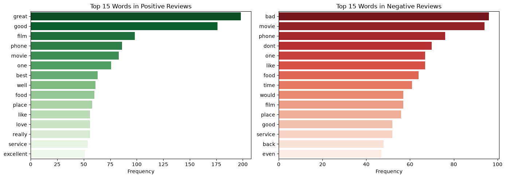
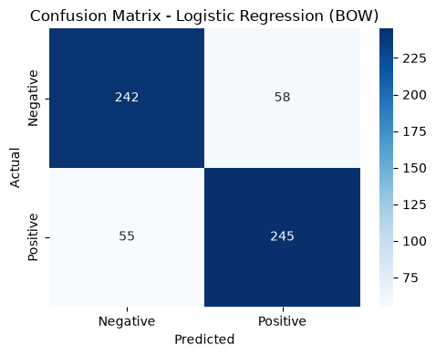

# Lab 01: Sentiment Analysis Using Traditional Machine Learning

## 1. Laboratory Session
* **Module:** PUSL3205 – Large Language Models and Generative AI
* **Lab Number & Title:** Lab 01 – Sentiment Analysis Using Traditional Machine Learning

## 2. Objective
The objective of this practical activity is to practice foundational Natural Language Processing (NLP) tasks—including text preprocessing, exploratory data analysis, Bag-of-Words (BoW) feature extraction, and supervised classification using traditional Machine Learning models (Logistic Regression and Linear SVM) on the UCI Sentiment Labelled Sentences dataset.

## 3. Tasks and Implementation
The implementation was completed in Python using Jupyter Notebook (`notebook/lab01_sentiment_analysis.ipynb`) with `pandas`, `numpy`, `nltk`, `scikit-learn`, `matplotlib`, and `seaborn`:

1. **Dataset Loading:** Downloaded and merged the Amazon, IMDb, and Yelp labelled review files from the UCI repository into a single balanced dataset of **3,000 sentences** (1,500 Positive, 1,500 Negative).
2. **Text Preprocessing:** Built a `clean_text()` pipeline using regular expressions to convert text to lowercase, strip punctuation and non-alphabetic characters, and normalize whitespace, storing the result in a `clean_text` column.
3. **Exploratory Data Analysis (EDA):** Inspected sample positive and negative reviews and plotted the top 15 most frequent non-stopword terms for each class.
4. **Train/Test Split:** Split the dataset into 80% training (2,400 samples) and 20% testing (600 samples) using stratified sampling (`random_state=42`).
5. **Bag-of-Words (BoW) Representation:** Vectorized the cleaned text using `CountVectorizer(stop_words='english', max_features=5000)`, producing a vocabulary of **4,389 unique features**.
6. **Model Training & Evaluation:** Trained and evaluated **Logistic Regression** and **Linear SVM (`LinearSVC`)** using Accuracy, Precision, Recall, F1-Score, and a Confusion Matrix.
7. **Inference Testing:** Tested the best-performing model (Logistic Regression) on four unseen sentences covering positive, negative, and mixed/neutral sentiment.

## 4. Results and Evidence

### Model Performance Comparison
| Model | Accuracy | Precision | Recall | F1-Score |
| :--- | :---: | :---: | :---: | :---: |
| **Logistic Regression** | **81.17%** | **0.8086** | 0.8167 | **0.8126** |
| **Linear SVM** | 78.83% | 0.7678 | **0.8267** | 0.7961 |

### Word Frequency Comparison

### Confusion Matrix (Logistic Regression)
Out of 600 test reviews, Logistic Regression correctly classified **242 True Negatives** and **245 True Positives**, with 58 False Positives and 55 False Negatives.

### Unseen Sentence Predictions
| Input Sentence | Predicted Sentiment |
| :--- | :---: |
| *"This product exceeded my expectations, absolutely brilliant quality!"* | Positive |
| *"Terrible service and the food arrived completely cold."* | Negative |
| *"The movie was okay, nothing special but not bad either."* | Negative |
| *"Worst purchase I have ever made. Complete waste of money."* | Negative |

## 5. Observations
* **Model Comparison:** Logistic Regression outperformed Linear SVM in overall accuracy (81.17% vs. 78.83%) and F1-Score (0.8126 vs. 0.7961), showing a more balanced trade-off between precision and recall on sparse BoW features.
* **Shared Domain Vocabulary:** Words such as `movie`, `phone`, `food`, `film`, and `place` appeared near the top of *both* positive and negative reviews, confirming that topic nouns carry no inherent sentiment on their own.
* **Limitations of Bag-of-Words:** In the unseen sentence test, *"The movie was okay, nothing special but not bad either"* was classified as **Negative**. Because BoW treats words independently and removes stopwords like *"not"*, it fails to capture negation (*"not bad"*) and nuanced/neutral phrasing—highlighting why context-aware Transformer models and LLMs are necessary for complex NLP tasks.

## 6. Learning Outcomes
* Gained hands-on experience building an end-to-end traditional NLP pipeline from raw text cleaning to model evaluation.
* Learned how to convert unstructured text into numerical feature matrices using Bag-of-Words (`CountVectorizer`).
* Understood the practical limitations of frequency-based text representations (loss of word order, context, and negation) compared to modern contextual embeddings and Large Language Models.